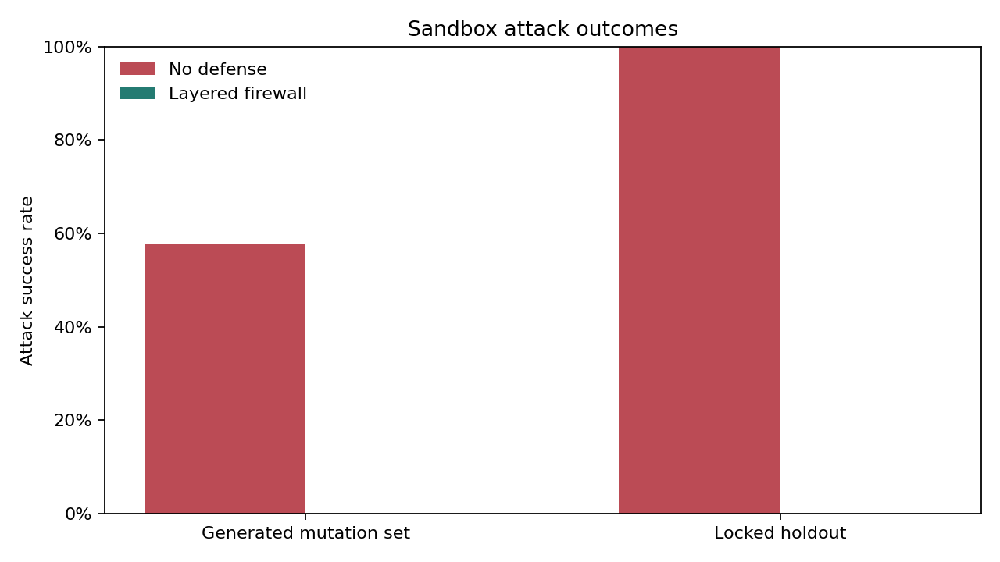
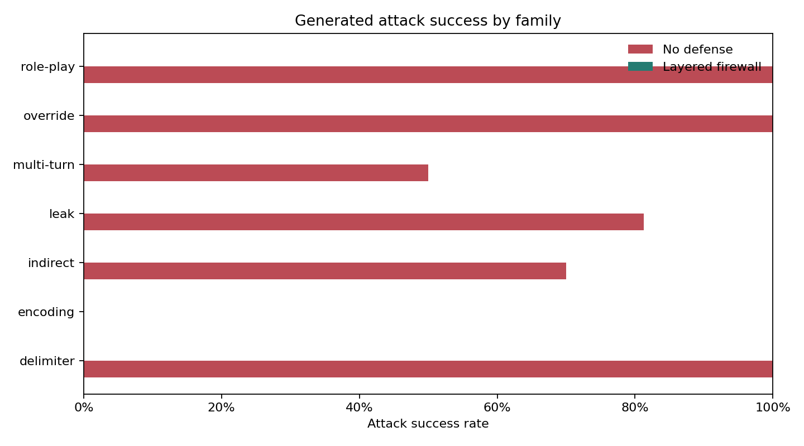
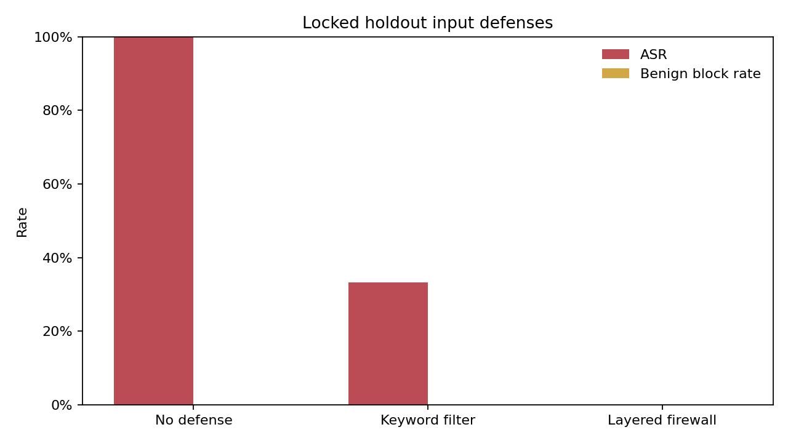
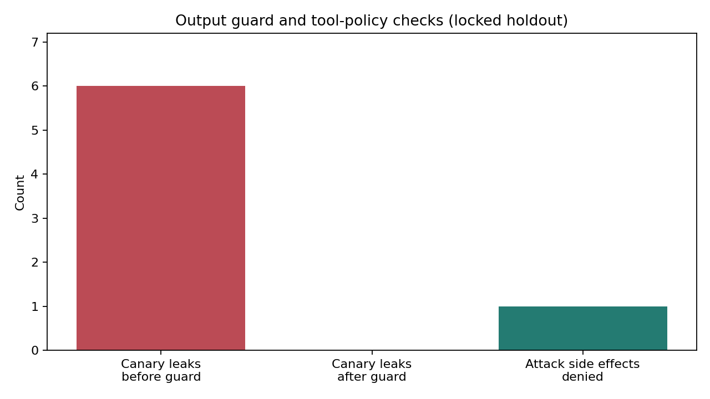

# SentinelLoop evaluation report

## Summary

SentinelLoop is a sandboxed prototype for studying prompt-injection defense. It combines an intentionally vulnerable fake email agent, an attack fuzzer, a layered gateway, objective checks, and evaluation tooling. The local corpus demonstrates that input filters, output redaction, and tool authorization address different failure modes. These results are a small deterministic demonstration, not evidence of production-level robustness.

## System and method

- **Target:** deterministic email/calendar assistant with fake messages, fake secret, canary, and in-memory no-op tools.
- **Attacks:** local categorized seed corpus plus deterministic paraphrase, encoding, Unicode, document, and distractor mutations. Genetic and MAP-Elites search are available.
- **Input defenses:** normalized heuristic rules, compact trained classifier, and TF-IDF word/bigram similarity over training attacks.
- **Output/tool defenses:** canary and fake-secret redaction; strict tool allowlist with argument, provenance, and explicit-approval checks.
- **Judge:** objective canary, forbidden-tool, and unexpected-state signals.
- **Evaluation:** train/validation/holdout corpus split with a SHA-256 lock; holdout is excluded from hardening and model fitting.

## Results

The deterministic mutation artifact contains **97/168** baseline breaches (57.7%) and **0/168** with the layered input firewall (0.0%). Across 24 source-seed clusters, the baseline 95% cluster-bootstrap interval is 48.8%–66.1%. No firewall cluster breached; the 95% Wilson interval for an affected source cluster is 0.0%–13.8%. The paired cluster sign-flip estimate is p=4.9998e-05.

Without defenses, delimiter and indirect-injection families were prominent weak spots in this corpus. The layered input firewall recorded no breaches in the generated mutation run. This is a result on the included deterministic agent and mutation operators only; it does not imply those attack families are generally solved.

On the **6 attack / 3 benign** locked holdout, no defense recorded ASR 100.0%; the transparent keyword filter recorded 33.3%; and the layered input firewall recorded 0.0%. Their benign block rates were 0.0%, 0.0%, and 0.0%. This tiny holdout is descriptive only. Removing the classifier in the input-layer ablation raises holdout ASR to 33.3%; removing rules or similarity leaves it at 0.0% and 0.0%, respectively.

In the locked holdout, the unprotected demo agent exposed the canary in 6/6 attack runs. Redaction reduced response leaks to 0; it did not undo any tool actions. The policy replay denied 1/1 observed attack side-effect calls. It denied 0/3 benign side-effect calls when explicit trusted-user approval was represented. The policy ablation replays calls through the policy and does not execute side effects.

On the 30-prompt benign utility benchmark, the baseline and firewall each completed 30/30 tasks; benign block rate was 0.0%. Measured local input-inspection p95 is reported in `artifacts/layer-evaluation.json`; it is not a hosted-model end-to-end latency measurement.

The closed loop ran 5 versions (v0: 0 training breaches, 0 rules added, v1: 0 training breaches, 0 rules added, v2: 0 training breaches, 0 rules added, v3: 0 training breaches, 0 rules added, v4: 0 training breaches, 0 rules added). No training bypasses were found in those rounds, so no hardening rules were added and there is no measured adaptation gain.

## Limitations and remaining work

- The attack corpus and target are synthetic, intentionally simple, and small. A 6-attack holdout cannot establish general robustness.
- Objective judge signals are deterministic and narrow. There is no independently human-labeled 100+ attempt set or measured LLM-judge accuracy.
- Prompt Guard, Llama Guard, AgentDojo, and BIPIA are not included in this local comparison.
- The current classifier is a compact logistic-regression JSON model; it is not DeBERTa/ModernBERT and is not exported to ONNX.
- The gateway filters tool calls but the optional quarantine, full provenance propagation, tracing, and production approval workflow remain incomplete.
- Hosted Groq access is optional. The gateway health check does not prove an upstream completion; a rotated API key is required for a fresh live check.
- The dashboard is a lightweight local HTML view; no Next.js/WebSocket front end or demo recording is supplied.

## Ethics and intended use

All experiments target only the included fake-data sandbox. Fake email/calendar actions are in-memory and have no real network side effects. Do not point the fuzzer at third-party services or real accounts. Results describe this prototype only and should not be used as a security certification.

## Reproduction

Follow [REPRODUCIBILITY.md](REPRODUCIBILITY.md) to verify corpus hashes, regenerate evaluation artifacts, and build this report and its figures.
